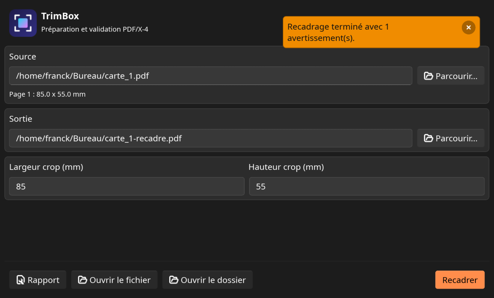

# Trimbox

[](https://www.gnu.org/licenses/gpl-3.0)

Trimbox est un outil Rust de ligne de commande avec une interface Slint optionnelle. Il permet de recadrer un document PDF aux dimensions finales souhaitées en indiquant une largeur et une hauteur en millimètres, sans mise à l'échelle ni ajout de repères. Il valide également et normalise les documents vers PDF/X-4, avec un rapport d'exécution. Le document généré respecte, dans la mesure du possible, les spécifications PDF/X-4.

Le noyau métier reste séparé de l'interface : la GUI est activée par la feature `gui`.

## Fonctionnalités

- Recadrage central sur toutes les pages d'un PDF, avec dimensions exactes en points PDF.
- Validation de la conformité PDF/X-4.
- Normalisation d'un document existant vers PDF/X-4.
- Lecture des boîtes de page (`MediaBox`, `TrimBox`, `BleedBox`, `CropBox`, `ArtBox`).
- Conservation des informations CMJN et des profils ICC lorsqu'elles sont présentes, avec repli explicite sinon.
- Rapport d'exécution et code de retour utilisable en script.
- Interface graphique focalisée sur le recadrage et l'affichage du rapport.

## Installation

### Depuis GitHub

```sh
cargo install --locked --git https://github.com/Franck-Demongin/trimbox.git --branch master --features gui
```

Cette commande installe `trimbox` et `trimbox-gui` sur Linux, `trimbox.exe` et `trimbox-gui.exe` sur Windows. Sur certaines machines, `~/.cargo/bin` n'est pas dans `PATH`.

### Dépendances de compilation sur Linux

```sh
sudo apt-get update
sudo apt-get install -y build-essential pkg-config \
  libfontconfig-dev libfreetype-dev libx11-dev \
  libxkbcommon-dev libwayland-dev libgl-dev
```

### Intégration Linux (bureau et icône)

Depuis une copie du dépôt :

```sh
cargo install --locked --path crates/cli --features gui
./packaging/linux/install-local.sh
```

Le script installe l'entrée de bureau sous le nom `io.github.Franck-Demongin.Trimbox.desktop` et les icônes hicolor sous le même identifiant.

## Utilisation en ligne de commande

```sh
trimbox pdf info fichier.pdf
trimbox pdf validate fichier.pdf
trimbox pdf normalize entree.pdf sortie.pdf
trimbox pdf crop --width 210 --height 297 entree.pdf sortie.pdf
```

Les dimensions de `crop` sont indiquées en millimètres (`--width`/`--height`).

## Interface graphique

Lancez l'interface graphique avec :

```sh
trimbox-gui
```

Ou, depuis le dépôt :

```sh
cargo run -p trimbox-cli --features gui --bin trimbox-gui
```



L'interface propose le recadrage et affiche le rapport résultat après l'opération.

## Développement

```sh
cargo fmt --check
cargo clippy --workspace --all-targets --all-features -- -D warnings
cargo test --workspace --all-features
cargo check -p trimbox-cli
cargo check -p trimbox-cli --features gui
```

## Licence

GPL-3.0-or-later. La licence open source de Slint impose une licence compatible pour une distribution open source. Une distribution propriétaire nécessite une licence commerciale Slint.
